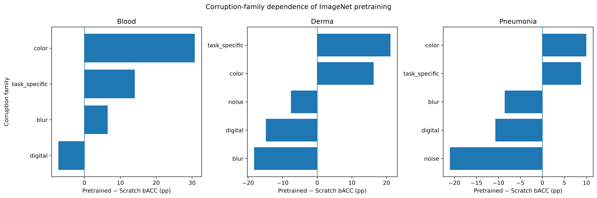
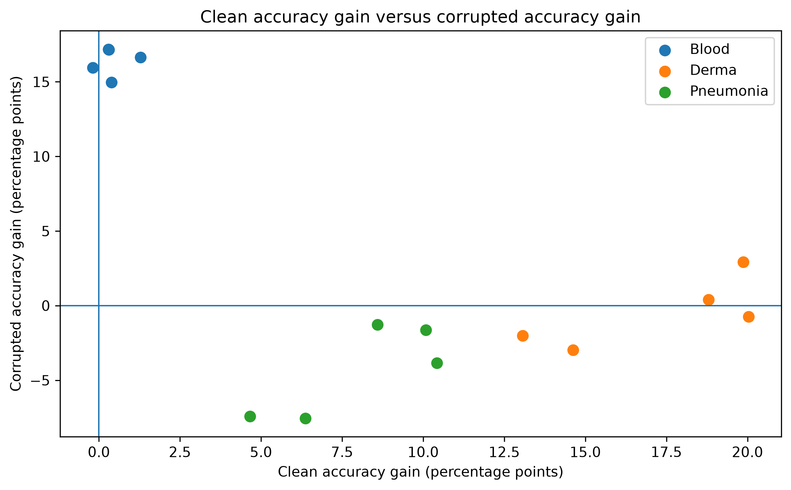
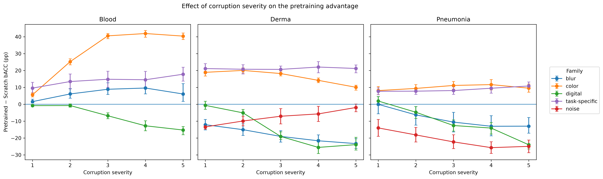

# Inherited or Learned? Decomposing the Contribution of ImageNet Pretraining to Corruption Robustness in Medical Image Classification

## Abstract

ImageNet pretraining is widely used in medical image classification, but it remains unclear whether robustness to image corruption is inherited from pretraining or learned primarily from the target medical dataset. We investigated this question using a controlled comparison between ImageNet-pretrained and randomly initialized ResNet-18 models on BloodMNIST, DermaMNIST, and PneumoniaMNIST evaluated with MedMNIST-C. Architecture, preprocessing, optimizer family, learning-rate schedule, model selection, and evaluation procedures were matched across initialization conditions, while condition-specific learning rates were used.

Across 30 core training runs and 18 training-set-size ablation runs, we evaluated clean balanced accuracy, corrupted balanced accuracy, balanced error, relative balanced error, corruption-family effects, and severity dependence. ImageNet initialization produced strongly heterogeneous robustness effects. On BloodMNIST, pretrained models achieved substantially higher mean corrupted balanced accuracy than scratch models (89.01% vs. 72.64%), whereas on DermaMNIST the two conditions were nearly equal (40.37% vs. 40.86%), and on PneumoniaMNIST scratch models performed better under corruption (76.54% vs. 72.19%).

Contrary to the preregistered H1 prediction, the task-specific-versus-generic interaction was reversed in direction on both BloodMNIST and DermaMNIST; the bootstrap interval excluded zero on DermaMNIST but narrowly included zero on BloodMNIST. Clean-set gains also did not provide a dataset-independent account of robustness gains: the preregistered pooled H3 analysis was negative, but post-hoc dataset-centered analyses showed that this pattern was strongly influenced by between-dataset differences. In the BloodMNIST data-size ablation, the clean pretraining advantage increased from +0.47 percentage points at 100% of the training data to +3.72 points at 10%. Under corruption, the corresponding advantage increased from +16.58 points at 100% to +23.40 points at 10%, although intermediate fractions were not strictly monotonic. Pretraining advantage also failed to decrease consistently with corruption severity, with only 2 of 14 dataset-by-family cells exhibiting the preregistered monotonic trend.

These results show that ImageNet initialization does not confer uniform corruption robustness in medical image classification. Its effect depends strongly on dataset, corruption family, training-data availability, and corruption severity. Clean accuracy and pretraining status alone are therefore insufficient indicators of robustness under distribution shift.

## Introduction

Deep neural networks for medical image classification are commonly initialized from models pretrained on large natural-image datasets such as ImageNet. Transfer learning is attractive because medical datasets are often smaller than general-purpose computer-vision datasets, and pretrained representations can improve optimization and data efficiency. However, the value of ImageNet pretraining in medical imaging is not uniform. Prior work has shown that transfer from natural images can provide only limited or highly context-dependent benefits on some medical imaging tasks, raising questions about which aspects of model performance are actually inherited from pretraining [3,6,7].

A separate concern is robustness to distribution shift. Standard test accuracy measures performance on images drawn from approximately the same distribution as the training data, but deployed medical images may differ because of acquisition artifacts, noise, compression, changes in contrast, blur, staining variation, or other image degradations. Robustness benchmarks based on controlled corruptions provide a reproducible way to study this problem.

The ImageNet-C benchmark established a widely used framework for evaluating model robustness to common image corruptions across multiple severity levels [1]. Subsequent work showed that pretraining can influence robustness and uncertainty in natural-image settings, suggesting that pretrained representations may contribute properties beyond conventional clean-set accuracy [2].

Whether the same relationship holds in medical imaging is less clear. Medical images differ substantially from ImageNet images in texture, color statistics, semantic structure, acquisition process, and task definition. A pretrained model may therefore inherit useful invariances from ImageNet, but it may also inherit sensitivities that are poorly matched to medical image corruptions.

MedMNIST provides a standardized collection of biomedical image-classification datasets spanning multiple modalities and tasks [4]. MedMNIST-C extends this benchmark with generic, task-specific, and modality-motivated corruptions at multiple severity levels, enabling controlled robustness evaluation across medical imaging datasets [5].

Existing MedMNIST-C evaluations primarily establish benchmark performance and examine robustness-enhancing interventions such as domain-informed augmentation [5]. However, corruption performance can reflect several sources simultaneously, including architecture, training data, augmentation, optimization, and initialization. This makes it difficult to isolate the contribution of ImageNet initialization itself.

In this work, we study that narrower question through a controlled comparison of ImageNet-pretrained and randomly initialized ResNet-18 models. Architecture, data splits, preprocessing, optimizer family, scheduling, stopping criteria, model selection, and evaluation procedures are matched across conditions, while initialization and the condition-specific learning rate differ. The learning-rate asymmetry is addressed transparently in the Methods and examined with a post-hoc symmetric sensitivity check.

We evaluate BloodMNIST, DermaMNIST, and PneumoniaMNIST using their corresponding MedMNIST-C corruption benchmarks. All three datasets include corruption families that allow the effect of initialization to be examined across generic and medically motivated distribution shifts. BloodMNIST and DermaMNIST were the datasets included in the preregistered task-specific-versus-generic H1 contrast, while PneumoniaMNIST task-specific gamma corruptions are analyzed descriptively.

Our analysis addresses four questions. First, does the contribution of ImageNet initialization depend on corruption family? Second, does the benefit of pretraining increase when medical training data are limited? Third, are improvements under corruption largely explained by improvements on clean data? Fourth, does the effect of pretraining change systematically with corruption severity?

The main finding is that ImageNet initialization does not confer a uniform corruption-robustness advantage. Its effect depends strongly on corruption family, dataset, training-set size, and severity. Task-specific corruptions often benefited from pretraining more than the pooled generic corruptions used in the preregistered H1 contrast, the relationship between clean gains and robustness gains was strongly dataset-dependent, and the value of pretraining increased clearly in the low-data BloodMNIST regime.

These results suggest that medical image robustness should not be inferred from clean performance or from the presence of ImageNet pretraining alone. Instead, the contribution of pretraining should be evaluated under the specific distribution shifts and data regimes relevant to the target imaging setting.

## Related Work

### Corruption robustness benchmarks

Controlled corruption benchmarks provide a standardized framework for measuring performance under non-adversarial image degradation. Hendrycks and Dietterich introduced ImageNet-C and related benchmarks to evaluate classifiers under common corruptions and perturbations rather than worst-case adversarial attacks. ImageNet-C applies multiple corruption types at several severity levels and has become a common reference for evaluating distribution-shift robustness.

The same general framework has increasingly been applied to medical imaging, where acquisition artifacts and modality-specific shifts can differ substantially from those encountered in natural images [5,9].

### MedMNIST and MedMNIST-C

MedMNIST v2 provides a standardized collection of lightweight biomedical image-classification datasets spanning multiple medical imaging modalities, dataset sizes, and prediction tasks [4]. The benchmark facilitates reproducible comparisons using common APIs and predefined data splits.

MedMNIST-C extends this collection specifically for corruption robustness. Di Salvo, Doerrich, and Ledig introduced corruptions designed to simulate both generic image degradation and artifacts motivated by particular medical datasets and imaging modalities [5]. The benchmark covers 12 two-dimensional MedMNIST datasets and nine imaging modalities and evaluates corruptions at five severity levels [5].

Their work demonstrated substantial vulnerability of medical classifiers to corruption and showed that targeted, domain-informed augmentation can improve robustness [5]. Our study uses the MedMNIST-C evaluation framework but asks a different question: rather than proposing a robustness intervention, we examine how model initialization itself changes corruption performance.

### ImageNet pretraining and robustness

ImageNet pretraining is widely used for transfer learning. Beyond data efficiency and optimization, pretraining has also been associated with robustness-related benefits. Hendrycks, Lee, and Mazeika showed that pretraining can improve robustness and uncertainty across several settings, including label corruption, adversarial examples, out-of-distribution detection, and calibration [2].

These findings motivate the possibility that robustness may be partially inherited from the source pretraining task. However, such conclusions cannot automatically be transferred to medical imaging because of the domain gap between natural and medical images.

Our study therefore does not test the broad proposition that pretraining can ever improve robustness. Instead, it asks a narrower question: how does supervised ImageNet initialization affect MedMNIST-C corruption performance relative to training the same architecture from scratch, and how does that effect vary across corruption families, data availability, and severity?

### Transfer learning in medical imaging

The usefulness of natural-image pretraining for medical imaging has been debated. Raghu et al. found that ImageNet transfer could provide surprisingly limited performance benefits in some medical imaging settings [3]. Later work showed that transfer gains depend on factors including target-data size, source-target distance, architecture, and feature reuse [6], while broader benchmarking has also demonstrated that alternative pretraining strategies can behave differently across medical tasks [7].

Together, this literature highlights an important distinction between conventional predictive performance and other properties that may be affected by initialization [3,6,7]. Even when clean-set gains are small, pretraining could still alter robustness; conversely, large clean-set improvements might not guarantee better performance under image degradation.

Medical-domain pretraining approaches such as Models Genesis further show that source-domain choice and self-supervised objectives can materially affect transfer behavior, especially when natural-image pretraining is poorly matched to the target modality [8]. Our experiments examine a narrower comparison by measuring clean performance and corruption robustness separately for supervised ImageNet initialization versus random initialization.

### Position of the present study

The present study sits at the intersection of medical transfer learning and corruption robustness.

Rather than comparing different robustness algorithms, architectures, or augmentation strategies, we perform a matched pretrained-versus-scratch comparison using the same ResNet-18 architecture and evaluation framework. This design allows us to examine the contribution associated with ImageNet initialization while keeping most of the training and evaluation pipeline fixed.

Our focus is therefore not the broad claim that pretraining improves robustness, but the narrower question of when ImageNet initialization helps, when it does not, and how its effect changes across medical corruption families, training-data regimes, and corruption severity.

## Methods

### Study design

We conducted a controlled comparison of ImageNet-pretrained and randomly initialized ResNet-18 models for medical image classification under common image corruptions. The architecture, official data splits, input preprocessing, optimizer family, learning-rate schedule, stopping criteria, model-selection rule, and evaluation pipeline were held fixed across initialization conditions. The two conditions differed in model initialization and in the learning rate used for training, as described below.

The study was preregistered before the core experiments in a timestamped Git commit on August 30, 2026 (commit `5b1f1b4`; https://github.com/rifatabrarjowad/medmnist-pretraining-robustness/commit/5b1f1b4). The primary endpoint was the interaction between initialization condition and corruption family, expressed using the difference in balanced error (BE) between pretrained and scratch models. Secondary preregistered analyses examined clean and corrupted balanced accuracy, training-set size, corruption severity, and the relationship between clean-accuracy gain and robustness gain.

Additional analyses introduced during revision are explicitly identified as post-hoc sensitivity or descriptive analyses and were not used to redefine the preregistered hypotheses.

### Datasets

We evaluated three datasets from the MedMNIST+ collection at 224 × 224 resolution [4]:

- BloodMNIST: eight-class blood-cell microscopy classification, with 11,959 training, 1,712 validation, and 3,421 test examples.
- DermaMNIST: seven-class dermatoscopic lesion classification, with 7,007 training, 1,003 validation, and 2,005 test examples.
- PneumoniaMNIST: binary chest X-ray classification, with 4,708 training, 524 validation, and 624 test examples.

Official predefined train, validation, and test splits were used without re-splitting.

Corrupted evaluation sets were obtained from MedMNIST-C [5]. BloodMNIST-C contained 11 corruption types, DermaMNIST-C contained 15, and PneumoniaMNIST-C contained 13. Each corruption was evaluated at five severity levels.

BloodMNIST-C included the task-specific corruptions `stain_deposit` and `bubble`. DermaMNIST-C included the task-specific corruptions `black_corner` and `characters`. PneumoniaMNIST-C included the task-specific gamma corruptions `gamma_corr_up` and `gamma_corr_down`.

For the preregistered H1 contrast, task-specific-versus-generic corruption-family comparisons were defined for BloodMNIST and DermaMNIST. PneumoniaMNIST task-specific results were analyzed descriptively during revision and were not added retrospectively to the preregistered H1 test.

### Model

All primary experiments used ResNet-18.

For the pretrained condition, the network was initialized with the torchvision `IMAGENET1K_V1` ResNet-18 weights. For the scratch condition, the same architecture was initialized randomly using `weights=None`.

The final fully connected layer was replaced to match the number of classes in each dataset.

No alternative architecture was used in the primary experiment.

### Input preprocessing

All images were loaded at 224 × 224 resolution and converted to three-channel RGB input using the MedMNIST `as_rgb=True` option.

Both initialization conditions used the same ImageNet normalization:

- mean = [0.485, 0.456, 0.406]
- standard deviation = [0.229, 0.224, 0.225]

No stochastic data augmentation was used during training. Inputs were converted to tensors and normalized using ImageNet mean and standard deviation; no random crop, flip, rotation, or corruption-based augmentation was applied.

### Training procedure

Models were trained using AdamW with a batch size of 64.

The pretrained condition used a learning rate of 1 × 10^-4. The scratch condition used a learning rate of 3 × 10^-4.

A cosine annealing learning-rate schedule was used with a maximum training budget of 50 epochs. Early stopping was based on validation balanced accuracy with a patience of 10 epochs. The checkpoint corresponding to the highest validation balanced accuracy was retained for evaluation.

### Learning-rate selection and sensitivity check

Before the core experiment, the scratch learning rate was selected using a validation-based search on BloodMNIST seed 0 over:

- 1 × 10^-4
- 3 × 10^-4
- 1 × 10^-3

That original search evaluated scratch initialization only and used a shorter training-search configuration than the final core protocol. It also converted BloodMNIST input to three channels through a grayscale-to-RGB transform rather than using the final `as_rgb=True` input pipeline. The best validation balanced accuracy in that search was obtained at 3 × 10^-4, which was then fixed for all scratch models in the core experiment. The pretrained learning rate of 1 × 10^-4 was fixed for the pretrained condition.

Because this original tuning procedure was asymmetric across initialization conditions, we conducted a post-hoc symmetric learning-rate sensitivity check during revision. Both pretrained and scratch models were evaluated on BloodMNIST seed 0 using the same candidate grid of 1 × 10^-4, 3 × 10^-4, and 1 × 10^-3, the final `as_rgb=True` preprocessing pipeline, the same AdamW optimizer and cosine schedule, a 50-epoch maximum, and patience of 10 epochs. Selection was based only on validation balanced accuracy; test-set performance was not used.

The validation-optimal rates from this symmetric check matched the rates used in the core experiment: 1 × 10^-4 for pretrained models and 3 × 10^-4 for scratch models. This sensitivity analysis was post hoc and does not replace the original learning-rate selection procedure.

### Random seeds and core experiment

The core experiment used five random seeds:

0, 1, 2, 3, and 4.

For each of the three datasets, both initialization conditions were trained for all five seeds:

3 datasets × 2 initialization conditions × 5 seeds = 30 core training runs.

No completed seed was removed as an outlier.

### Training-set size ablation

To test the effect of data availability, an additional BloodMNIST ablation was conducted using 50%, 25%, and 10% of the original training set.

For each reduced fraction, pretrained and scratch models were trained using seeds 0, 1, and 2. The 100% condition used the corresponding core experiment models for seeds 0–2.

The reduced training subsets were sampled deterministically using a seed-specific random permutation of the BloodMNIST training indices. The first fraction-specific prefix of that permutation was used, making the 10%, 25%, and 50% subsets nested within seed. The same subset was therefore used for pretrained and scratch conditions at a given fraction and seed. Although the preregistration specified class-stratified subsampling, the implemented procedure was not explicitly stratified; this deviation was identified during revision and is documented in the accompanying deviation log. Validation and test sets were unchanged.

The reduced-data ablation therefore contributed:

3 reduced fractions × 2 initialization conditions × 3 seeds = 18 additional training runs.

Together, the preregistered core experiment and reduced-data ablation comprised 48 trained models. The six validation-only runs used for the later symmetric learning-rate sensitivity check were separate post-hoc diagnostic runs.

The preregistered H2 analysis evaluated clean balanced accuracy across the four training fractions. During revision, the same trained models were additionally evaluated on all BloodMNIST-C corruptions and severity levels to determine whether the low-data pattern also appeared under corruption. This corruption analysis of the training-fraction ablation was post hoc.

### Clean-set evaluation

Each selected checkpoint was evaluated on the official clean test split.

The primary clean-set metric was balanced accuracy, which assigns equal weight to each class and is therefore less sensitive than ordinary accuracy to class imbalance.

Results were summarized across matched random seeds.

### Corruption evaluation

For each dataset, every trained core checkpoint was evaluated on all available MedMNIST-C corruptions at severity levels 1 through 5.

Balanced accuracy was retained separately for each corruption type, severity level, initialization condition, and seed.

Corruptions were grouped into the following families where applicable:

- digital
- noise
- blur
- color/intensity
- task-specific

The effect of pretraining was oriented so that positive values indicated an advantage for ImageNet initialization.

For balanced accuracy:

ΔbACC = bACC_pretrained − bACC_scratch.

For balanced error:

ΔBE = BE_scratch − BE_pretrained.

Thus, positive ΔbACC or ΔBE indicates an advantage for the pretrained condition.

### Balanced error and relative balanced error

We used the MedMNIST-C evaluation framework for normalized robustness metrics.

Balanced error (BE) was treated as the primary normalized corruption metric. Relative balanced error (rBE) was treated as a secondary metric.

The implemented MedMNIST-C AlexNet baseline values were used for normalization [5].

For corruption c:

BE_c =
mean model corrupted balanced error for corruption c
/
AlexNet balanced error for corruption c.

Relative balanced error was defined as:

rBE_c =
(model corrupted error − model clean error)
/
(AlexNet corrupted error − AlexNet clean error).

BE values were first computed at the corruption level after aggregating across severity levels according to the evaluation pipeline.

### rBE denominator handling

A known limitation of rBE occurs when the AlexNet denominator is very small or negative.

For PneumoniaMNIST, `contrast_up` and `gamma_corr_up` produced negative AlexNet rBE denominators and were excluded from rBE aggregates according to the preregistered denominator rule.

Corruptions with denominator magnitude below 0.05 were flagged as potentially unstable. These flags were retained in the result tables so that rBE values could be interpreted cautiously.

No corresponding exclusion was applied to BE, which remained the primary normalized corruption metric.

Absolute degradation from clean to corrupted balanced accuracy was also examined alongside normalized metrics.

### Primary H1 analysis

The preregistered primary endpoint tested whether the benefit of ImageNet initialization was smaller for task-specific corruptions than for pooled noise, blur, and digital corruptions on BloodMNIST and DermaMNIST.

For each corruption, performance was aggregated across severity levels, and pretrained-versus-scratch effects were paired using matched experimental structure.

The primary interaction was defined as:

mean ΔBE_task-specific
−
mean ΔBE_noise/blur/digital.

Under this definition, a positive interaction indicates a larger pretraining advantage for task-specific corruptions. The preregistered directional hypothesis predicted the opposite pattern.

PneumoniaMNIST task-specific gamma corruptions were not included retrospectively in this confirmatory H1 contrast.

### Statistical analysis

Main performance summaries were reported as means and standard deviations across seeds where applicable.

For corruption-level robustness comparisons, corruption type was treated as the unit of pairing.

Two-sided Wilcoxon signed-rank tests were applied to per-corruption ΔBE values within each dataset.

Bootstrap 95% confidence intervals were estimated using 10,000 resamples for family-level effects and for the primary task-specific interaction. Because some corruption-family comparisons contained very few corruption types, these bootstrap intervals were treated primarily as descriptive uncertainty estimates.

Holm-Bonferroni correction was applied across the family-level Wilcoxon tests within each dataset. The nominal significance threshold was $\alpha$ = 0.05.

For the training-fraction and severity hypotheses, direction, effect size, paired-seed behavior, and uncertainty intervals were emphasized rather than fitting additional regression models.

### H2 low-data analysis

H2 tested whether the balanced-accuracy advantage of pretraining increased as the available BloodMNIST training data decreased from 100% to 50%, 25%, and 10%.

For clean performance, the pretrained-minus-scratch balanced-accuracy gap was calculated separately at each training fraction.

The post-hoc corruption extension evaluated the same models across all 11 BloodMNIST-C corruption types and five severity levels. For each condition and seed, corrupted balanced accuracy was averaged across corruption types and severity levels, after which pretrained-minus-scratch gaps were calculated.

To directly compare the most data-rich and most data-limited regimes, we also computed the paired seed-wise change in the pretraining advantage between the 100% and 10% training fractions. This comparison was performed separately for clean and corrupted balanced accuracy.

Because only three paired seeds were available for the reduced-data conditions, bootstrap intervals from these analyses were interpreted descriptively.

### H3 clean-performance versus robustness analysis

H3 tested whether gains in corrupted performance were largely explained by clean-set gains.

For each dataset and seed, pretrained-minus-scratch differences were computed for:

- clean balanced accuracy,
- mean corrupted balanced accuracy,
- absolute clean-to-corrupted degradation,
- BE,
- rBE.

The preregistered analysis examined the relationship between clean-accuracy gain and robustness gain across the 15 paired dataset-seed observations from three datasets and five seeds.

Because these observations contain repeated seeds nested within only three datasets, the pooled Pearson and Spearman correlations were treated descriptively rather than as independent-sample confirmatory inference.

During revision, two post-hoc sensitivity analyses were added to examine whether the pooled association was driven by between-dataset differences.

First, Pearson and Spearman correlations were calculated separately within each dataset using the five paired seeds.

Second, clean gain, corrupted-performance gain, and BE advantage were centered by subtracting their dataset-specific means before calculating pooled correlations on the centered values.

These post-hoc analyses were used to diagnose between-dataset structure and did not alter the preregistered H3 decision rule.

### Clean-performance and floor-effect sensitivity analysis

A post-hoc sensitivity analysis examined whether differences in corruption performance could be explained by different clean-performance baselines or by performance approaching chance level.

For each dataset, initialization condition, and seed, we calculated:

absolute drop =
clean balanced accuracy
−
mean corrupted balanced accuracy.

We also calculated the fraction of above-chance clean performance retained under corruption:

retained fraction =
(mean corrupted balanced accuracy − chance balanced accuracy)
/
(clean balanced accuracy − chance balanced accuracy).

Chance balanced accuracy was defined as:

- BloodMNIST: 1/8
- DermaMNIST: 1/7
- PneumoniaMNIST: 1/2

A retained fraction of 1 indicates complete preservation of above-chance clean performance under corruption, whereas a value of 0 indicates reduction to chance-level balanced accuracy.

The corresponding chance-normalized drop was defined as:

chance-normalized drop = 1 − retained fraction.

This analysis was post hoc and was used only as a robustness sensitivity check.

### H4 severity analysis

H4 tested whether the pretrained-minus-scratch balanced-accuracy gap decreased monotonically as corruption severity increased from level 1 through level 5.

For each dataset × corruption-family cell, pretrained-minus-scratch balanced-accuracy differences were calculated separately at each severity level.

A cell satisfied the preregistered H4 directional pattern only if the gap decreased strictly and monotonically across all five severity levels.

After correcting the PneumoniaMNIST gamma corruptions to the task-specific family, the severity analysis contained 14 dataset-by-family cells in total.

Severity-specific paired-seed bootstrap confidence intervals were additionally calculated as descriptive uncertainty estimates.

### Software and hardware

Experiments were implemented in Python using PyTorch, torchvision, MedMNIST, MedMNIST-C, scikit-learn, pandas, NumPy, SciPy, and Matplotlib.

Training and evaluation were executed using the PyTorch MPS backend on Apple Silicon when available.

All experiment scripts, analysis code, configuration decisions, and result tables are maintained in the accompanying repository for reproducibility.

## Results

### Clean and corrupted performance

ImageNet initialization improved clean balanced accuracy on all three datasets, but its effect on corruption performance varied substantially across datasets. On BloodMNIST, pretrained models achieved 99.02% mean clean balanced accuracy compared with 98.60% for models trained from scratch. Under corruption, this difference widened substantially: pretrained models achieved 89.01% mean corrupted balanced accuracy, compared with 72.64% for scratch models.

On DermaMNIST, ImageNet initialization produced a much larger clean-set advantage, with mean clean balanced accuracy of 72.65% for pretrained models and 55.38% for scratch models. This advantage did not carry over to corrupted performance. Mean corrupted balanced accuracy was 40.37% for pretrained models and 40.86% for scratch models.

A similar divergence appeared on PneumoniaMNIST. Pretrained models achieved 88.90% mean clean balanced accuracy compared with 80.87% for scratch models, but under corruption the pretrained models performed worse on average, with 72.19% balanced accuracy compared with 76.54% for scratch models.

Thus, improved clean performance from ImageNet initialization did not consistently correspond to improved performance under corruption.

**Table 1. Clean and corrupted performance by dataset and initialization condition.**

| Dataset | Initialization | Clean bACC (%) | Corrupted bACC (%) | BE | rBE |
|:--|:--|--:|--:|--:|--:|
| Blood | Pretrained | 99.02 ± 0.21 | 89.01 ± 0.95 | 1.27 ± 0.11 | 1.62 ± 0.12 |
| Blood | Scratch | 98.60 ± 0.43 | 72.64 ± 1.00 | 3.84 ± 0.15 | 5.85 ± 0.31 |
| Derma | Pretrained | 72.65 ± 2.97 | 40.37 ± 2.07 | 0.97 ± 0.04 | 1.78 ± 0.11 |
| Derma | Scratch | 55.38 ± 0.82 | 40.86 ± 0.84 | 0.98 ± 0.01 | 0.75 ± 0.08 |
| Pneumonia | Pretrained | 88.90 ± 1.77 | 72.19 ± 3.52 | 1.04 ± 0.14 | 0.99 ± 0.13 |
| Pneumonia | Scratch | 80.87 ± 1.78 | 76.54 ± 1.46 | 1.08 ± 0.06 | 0.43 ± 0.07 |

### Corruption-family dependence

The effect of ImageNet initialization varied strongly across corruption families.

On BloodMNIST, color corruptions showed the largest mean pretraining advantage, with a pretrained-minus-scratch balanced-accuracy difference of +30.74 percentage points and a mean ΔBE of +5.53. Task-specific corruptions also favored pretrained models (+14.04 points; ΔBE = +0.77), as did blur corruptions (+6.46 points; ΔBE = +0.32). Digital corruptions instead favored scratch training (-7.27 points; ΔBE = -0.78).

On DermaMNIST, task-specific corruptions showed the largest mean pretraining benefit (+21.17 percentage points; ΔBE = +0.36), followed by color corruptions (+16.29 points; ΔBE = +0.33). In contrast, blur (-18.22 points; ΔBE = -0.29), digital (-14.85 points; ΔBE = -0.31), and noise (-7.60 points; ΔBE = -0.10) favored scratch-trained models.

PneumoniaMNIST also included task-specific gamma corruptions. These task-specific corruptions favored pretraining (+8.79 percentage points; ΔBE = +0.72), as did color corruptions (+9.97 points; ΔBE = +0.56). In contrast, noise (-21.01 points; ΔBE = -0.50), digital (-10.69 points; ΔBE = -0.41), and blur (-8.57 points; ΔBE = -0.31) favored scratch training.

The preregistered H1 analysis was defined for BloodMNIST and DermaMNIST and predicted that the benefit of ImageNet initialization would be smaller for task-specific corruptions than for pooled noise, blur, and digital corruptions. The observed interaction was reversed in direction on both datasets: +1.0009 ΔBE on BloodMNIST and +0.5657 ΔBE on DermaMNIST. Paired-seed bootstrap 95% confidence intervals were [-0.0094, 2.0111] for BloodMNIST and [0.4799, 0.6604] for DermaMNIST; thus, the interval narrowly included zero on BloodMNIST but excluded zero on DermaMNIST. These bootstrap intervals are reported as descriptive uncertainty estimates rather than multiplicity-adjusted confirmatory interaction tests.

Because the observed interaction was opposite to the preregistered directional prediction, H1 was rejected.

At the dataset level, two-sided Wilcoxon signed-rank tests on per-corruption ΔBE values yielded W = 9, p = 0.032 for BloodMNIST; W = 57, p = 0.890 for DermaMNIST; and W = 38, p = 0.635 for PneumoniaMNIST. Family-level Wilcoxon tests were additionally adjusted within dataset using the Holm-Bonferroni procedure; none of the family-level comparisons remained significant after correction. The corresponding PneumoniaMNIST task-specific results are reported descriptively and were not part of the preregistered H1 contrast.

**Table 2. Corruption-family effects of ImageNet initialization.**

| Dataset | Corruption family | N corruptions | ΔbACC (pp) | ΔBE |
|:--|:--|--:|--:|--:|
| Blood | Blur | 2 | +6.46 | +0.32 |
| Blood | Color/intensity | 5 | +30.74 | +5.53 |
| Blood | Digital | 2 | -7.27 | -0.78 |
| Blood | Task-specific | 2 | +14.04 | +0.77 |
| Derma | Blur | 3 | -18.22 | -0.29 |
| Derma | Color/intensity | 4 | +16.29 | +0.33 |
| Derma | Digital | 2 | -14.85 | -0.31 |
| Derma | Noise | 4 | -7.60 | -0.10 |
| Derma | Task-specific | 2 | +21.17 | +0.36 |
| Pneumonia | Blur | 1 | -8.57 | -0.31 |
| Pneumonia | Color/intensity | 4 | +9.97 | +0.56 |
| Pneumonia | Digital | 2 | -10.69 | -0.41 |
| Pneumonia | Noise | 4 | -21.01 | -0.50 |
| Pneumonia | Task-specific | 2 | +8.79 | +0.72 |

### Training-set size ablation

The preregistered H2 analysis examined whether the benefit of ImageNet initialization increased as the available BloodMNIST training data decreased.

For clean balanced accuracy, the pretrained-minus-scratch gap was +0.47 percentage points at 100% of the training set (95% bootstrap CI: -0.19 to +1.29), +0.79 points at 50% (95% CI: +0.69 to +0.96), +1.03 points at 25% (95% CI: +0.90 to +1.17), and +3.72 points at 10% (95% CI: +2.36 to +6.09). The clean-set gap therefore increased monotonically as the available training data decreased.

We additionally evaluated the same training-fraction models under BloodMNIST-C corruptions. Averaged across all 11 corruptions and five severity levels, the pretrained-minus-scratch corrupted balanced-accuracy gap was +16.58 percentage points at 100% of the training data (95% bootstrap CI: +15.94 to +17.14), +18.12 points at 50% (95% CI: +17.12 to +19.39), +17.07 points at 25% (95% CI: +15.27 to +20.49), and +23.40 points at 10% (95% CI: +19.89 to +28.62). Unlike the clean-set gaps, the corrupted-performance gaps were not strictly monotonic across all intermediate fractions, but the largest advantage occurred in the most data-limited 10% condition.

A paired seed-wise comparison of the 10% and 100% conditions showed that reducing the training set from 100% to 10% increased the pretraining advantage by a mean of +3.25 percentage points on clean data and +6.83 points under corruption. All three paired seeds showed an increase in both analyses. Because the reduced-data experiments used only three paired seeds, the associated bootstrap intervals are interpreted descriptively.

Taken together, these results support H2: the advantage of ImageNet initialization was larger in the most data-limited BloodMNIST regime, both on clean data and under corruption.

### Clean accuracy versus corruption robustness

The preregistered H3 analysis examined whether gains under corruption were largely explained by gains on clean data.

At the dataset level, the patterns differed sharply. On BloodMNIST, the mean clean balanced-accuracy gain from pretraining was only +0.42 percentage points, whereas the mean corrupted-set gain was +16.38 points. On DermaMNIST, the clean gain was +17.28 points, but the corrupted-set gain was -0.48 points. On PneumoniaMNIST, the clean gain was +8.03 points, while the corrupted-set gain was -4.35 points.

Across the 15 paired dataset-seed observations, clean-accuracy gain was negatively associated with corrupted-accuracy gain (Pearson r = -0.63; Spearman $\rho$ = -0.46). Clean gain was also negatively associated with BE advantage (Pearson r = -0.79; Spearman $\rho$ = -0.63). Because these observations comprise repeated seeds from only three datasets, these pooled correlations are descriptive rather than independent-sample confirmatory tests.

A post-hoc decomposition showed that the pooled negative association was strongly influenced by between-dataset differences. After centering clean gain and robustness gain within each dataset, the association between clean gain and corrupted-accuracy gain became positive (Pearson r = +0.74; Spearman $\rho$ = +0.69). The centered association between clean gain and BE advantage was also positive (Pearson r = +0.58; Spearman $\rho$ = +0.44).

Within-dataset correlations were heterogeneous and were based on only five paired seeds per dataset. For clean gain versus corrupted-accuracy gain, Pearson correlations were +0.18 on BloodMNIST, +0.76 on DermaMNIST, and +0.81 on PneumoniaMNIST. The corresponding Spearman correlations were -0.20, +0.60, and +0.50. For clean gain versus BE advantage, Pearson correlations were -0.65 on BloodMNIST, +0.82 on DermaMNIST, and +0.84 on PneumoniaMNIST. These within-dataset estimates are therefore treated as descriptive sensitivity analyses rather than confirmatory hypothesis tests.

The preregistered pooled analysis did not support the expectation that gains under corruption were largely explained by clean-set gains, and H3 was rejected according to the preregistered analysis. However, the post-hoc decomposition indicates that the negative pooled association should not be interpreted as evidence that larger clean gains intrinsically reduce corruption robustness.

### Sensitivity to clean-performance and chance-level differences

Because pretrained and scratch models differed substantially in clean accuracy on DermaMNIST and PneumoniaMNIST, we conducted a post-hoc sensitivity analysis to assess whether the corruption results could be explained by clean-performance differences or floor effects.

For each dataset, we measured the absolute drop from clean to mean corrupted balanced accuracy and the fraction of above-chance clean performance retained under corruption. Chance balanced accuracy was defined as 1/8 for BloodMNIST, 1/7 for DermaMNIST, and 1/2 for PneumoniaMNIST.

On BloodMNIST, pretrained models showed a smaller absolute clean-to-corrupted drop than scratch models (10.00 vs. 25.96 percentage points) and retained a larger fraction of their above-chance clean performance (0.884 vs. 0.699).

On DermaMNIST, pretrained models showed a larger absolute drop than scratch models (32.28 vs. 14.52 percentage points) and retained a smaller fraction of above-chance clean performance (0.447 vs. 0.647).

On PneumoniaMNIST, pretrained models likewise showed a larger absolute drop (16.71 vs. 4.33 percentage points) and retained less above-chance clean performance (0.568 vs. 0.861).

Thus, the heterogeneous corruption results were not explained solely by the lower clean accuracy of scratch models or by chance-level floor effects. The sensitivity analysis reinforced the dataset-dependent pattern: pretraining improved retained corruption performance on BloodMNIST but not on DermaMNIST or PneumoniaMNIST.

### Severity dependence

The preregistered H4 predicted that the pretrained-minus-scratch balanced-accuracy gap would decrease monotonically as corruption severity increased from level 1 to level 5.

This pattern was uncommon. Only 2 of 14 dataset-by-corruption-family cells (14.3%) showed a strictly monotonic decrease across severity levels. These were DermaMNIST blur and PneumoniaMNIST digital corruptions.

At the dataset level, BloodMNIST showed the opposite overall tendency. The mean pretraining advantage increased from +4.44 percentage points at severity 1 to +14.90 points at severity 2 and +21.50 points at severity 3, before remaining high at +21.13 points at severity 4 and +19.93 points at severity 5.

DermaMNIST shifted from a small pretrained advantage at lower severity (+1.79 points at severity 1 and +1.78 points at severity 2) to a scratch advantage at higher severity (-0.63 points at severity 3, -2.53 points at severity 4, and -2.84 points at severity 5).

PneumoniaMNIST increasingly favored scratch training as severity increased, from -0.33 percentage points at severity 1 to -2.71 points at severity 2, -4.92 points at severity 3, -6.03 points at severity 4, and -7.76 points at severity 5.

Because strictly monotonic decreases occurred in only a small minority of dataset-by-family cells, H4 was rejected.

### Summary of hypothesis tests

Of the four preregistered hypotheses, only H2 was supported. H1, H3, and H4 were rejected according to their preregistered directional predictions and analysis definitions.

The additional post-hoc analyses refined, but did not replace, these preregistered conclusions. Corruption evaluation of the BloodMNIST data-size ablation showed the largest pretraining advantage in the 10% training regime; dataset-centered H3 analyses showed that the negative pooled clean-versus-robustness association was strongly influenced by between-dataset differences; and chance-normalized degradation analyses showed that the heterogeneous robustness effects were not explained solely by clean-performance differences or floor effects.

Overall, ImageNet initialization did not produce a uniform corruption-robustness benefit. Its effect depended strongly on the dataset, corruption family, training-data availability, and corruption severity.

**Table 3. Summary of preregistered hypotheses and outcomes.**

| Hypothesis | Prediction | Key result | Verdict |
|:--|:--|:--|:--|
| H1 | Task-specific pretraining benefit smaller than pooled noise/blur/digital | Direction reversed on Blood (+1.0009 ΔBE) and Derma (+0.5657 ΔBE) | Rejected |
| H2 | Pretraining benefit increases as BloodMNIST training data decrease | Clean gap +0.47 pp → +3.72 pp; post-hoc corruption extension: +16.58 pp → +23.40 pp from 100% to 10% | Supported |
| H3 | Corrupted-performance gains largely explained by clean-set gains | Preregistered pooled association negative; post-hoc centered analysis showed strong between-dataset influence | Rejected |
| H4 | Pretraining benefit decreases monotonically with severity | Only 2 of 14 dataset-by-family cells strictly decreased | Rejected |

## Discussion

This study examined how much corruption robustness in medical image classification can be attributed to ImageNet initialization rather than to learning from the target medical dataset alone. The central finding is that ImageNet pretraining did not provide a uniform robustness advantage. Its effect depended strongly on the dataset, corruption family, training-set size, and corruption severity.

Three of the four preregistered hypotheses were rejected according to their original directional predictions and analysis definitions. These results challenge several simple interpretations of transfer learning. Task-specific corruptions did not show the smaller pretraining benefit that had been predicted, gains under corruption were not well summarized by clean-set gains alone, and increasing corruption severity did not produce a consistent reduction in the pretraining advantage. In contrast, the benefit of ImageNet initialization increased clearly in the most data-limited BloodMNIST regime.

### Pretraining robustness is corruption-family dependent

The strongest recurring pattern was heterogeneity across corruption families.

On BloodMNIST, ImageNet initialization provided large improvements for color/intensity and task-specific corruptions, while digital corruptions favored training from scratch. On DermaMNIST, task-specific and color corruptions again favored pretrained models, whereas noise, blur, and digital corruptions favored scratch-trained models. PneumoniaMNIST showed a related split: task-specific gamma and color/intensity corruptions favored pretraining, while noise, blur, and digital corruptions generally favored scratch training.

This pattern indicates that robustness should not be treated as a single model property. A model can be more robust to one family of distribution shifts while simultaneously being less robust to another.

The result is especially notable for task-specific corruptions. H1 predicted that the ImageNet pretraining benefit would be smaller for task-specific medical corruptions than for pooled noise, blur, and digital corruptions. Instead, the observed interaction was in the opposite direction on both BloodMNIST and DermaMNIST; the bootstrap interval excluded zero on DermaMNIST but narrowly included zero on BloodMNIST. PneumoniaMNIST task-specific gamma results showed a similar descriptive tendency, although PneumoniaMNIST was not part of the preregistered H1 contrast.

One possible interpretation is that ImageNet initialization provides representations that remain useful under certain structured visual changes, even when those changes are specific to medical imagery. However, the present experiments do not identify the representation-level mechanism responsible for this behavior. Feature-space, frequency-response, or attribution analyses would be needed to test such explanations directly.

### Clean accuracy and corruption robustness capture different behavior

The results show that clean performance alone is insufficient to characterize robustness.

BloodMNIST showed only a small clean balanced-accuracy advantage from ImageNet initialization, yet pretraining produced a large mean advantage under corruption. DermaMNIST showed the opposite pattern: pretraining produced a large improvement on clean images but almost no average corrupted-set advantage. PneumoniaMNIST similarly showed a substantial clean improvement while scratch-trained models performed better on corrupted data on average.

In the preregistered pooled H3 analysis, the relationship across the 15 dataset-seed pairs was negative: larger clean gains were associated with smaller corrupted-accuracy gains and smaller BE advantages. However, the 15 observations were not independent samples from a common population; they consisted of repeated seeds from only three datasets.

A post-hoc decomposition showed that the pooled negative association was strongly influenced by between-dataset differences. After centering clean gain and robustness gain within each dataset, the association reversed direction and became positive for both corrupted-accuracy gain and BE advantage. Within-dataset correlations were also heterogeneous, with positive associations on DermaMNIST and PneumoniaMNIST but weaker or mixed patterns on BloodMNIST.

This distinction is important. The preregistered H3 result remains rejected because the original pooled analysis did not support the hypothesis that corrupted-performance gains were largely explained by clean-set gains. However, the pooled negative correlation should not be interpreted as evidence that larger clean improvements intrinsically cause worse robustness. Instead, the analyses indicate that clean-set and corruption performance capture related but distinct aspects of model behavior, and their relationship depends strongly on the dataset.

This conclusion is reinforced by the degradation sensitivity analysis. After accounting for both clean performance and chance-level balanced accuracy, pretrained models retained more of their above-chance performance than scratch models on BloodMNIST, but retained less on DermaMNIST and PneumoniaMNIST. The heterogeneous robustness pattern therefore cannot be explained solely by lower scratch-model clean accuracy or by floor effects.

### ImageNet pretraining becomes more valuable in the low-data regime

H2 was the only preregistered hypothesis that was supported.

On BloodMNIST, the clean balanced-accuracy advantage of ImageNet initialization increased monotonically as the available training data decreased. The gap was approximately 0.47 percentage points with the full training set but increased to approximately 3.72 points when only 10% of the training data was available.

The additional corruption analysis showed the same broad low-data pattern, although the intermediate fractions were not strictly monotonic. The mean corrupted-performance advantage was approximately 16.58 percentage points at 100% of the training data, 18.12 points at 50%, 17.07 points at 25%, and 23.40 points at 10%. Thus, the largest robustness benefit also occurred in the most data-limited regime.

A paired comparison between the 100% and 10% conditions showed that reducing the available training data increased the pretraining advantage by approximately 3.25 percentage points on clean data and 6.83 points under corruption, with all three paired seeds showing increases.

This result is consistent with prior evidence that the value of transfer learning can depend strongly on target-dataset size and available supervision [6]. It also extends that intuition beyond clean accuracy by showing that the robustness advantage of pretraining can become larger when labeled medical data are scarce.

The ablation was conducted only on BloodMNIST, and the reduced-data conditions used three paired seeds. The same relationship should therefore not automatically be assumed for DermaMNIST, PneumoniaMNIST, or other medical imaging datasets.

### Severity does not produce a universal pretraining trend

H4 predicted that the advantage of ImageNet initialization would decrease monotonically as corruption severity increased. This pattern appeared in only 2 of the 14 dataset-by-family cells.

Instead, several qualitatively different severity responses were observed.

BloodMNIST showed an overall increase in pretraining advantage from low to moderate severity, followed by a plateau or slight reduction at the highest severity. DermaMNIST shifted from a small pretrained advantage at lower severity to a scratch advantage at higher severity. PneumoniaMNIST increasingly favored scratch training as severity increased at the dataset level.

At the family level, only DermaMNIST blur and PneumoniaMNIST digital corruptions satisfied the preregistered strictly monotonic decreasing pattern. Other families showed increasing, stable, reversing, or non-monotonic effects.

Therefore, corruption severity cannot be interpreted simply as scaling the same robustness difference between pretrained and scratch models. Increasing severity can change both the magnitude and, in some cases, the direction of the initialization effect.

This observation supports reporting severity-resolved results rather than relying only on a single average across all severity levels.

### Why might ImageNet initialization help some corruptions but hurt others?

The present experiments were designed to establish the existence and structure of the effect rather than to identify its internal mechanism. Nevertheless, several explanations motivate future investigation.

ImageNet pretraining may encourage sensitivity to particular textures, color statistics, edges, or spatial-frequency patterns. Some corruption families may preserve useful pretrained features, whereas others may disrupt them disproportionately. Scratch-trained models may develop different dataset-specific cues that happen to remain stable under certain noise, blur, or digital transformations.

Differences in imaging modality may also matter. BloodMNIST and DermaMNIST contain color information, whereas PneumoniaMNIST consists of chest radiographs. However, only three datasets were evaluated, so the current study cannot establish a modality-level explanation.

These possibilities should therefore be viewed as hypotheses for future representation-level analysis rather than conclusions from the current results.

### Implications for robustness evaluation

The findings have several practical implications for evaluating medical image classifiers.

First, reporting only clean test accuracy can conceal substantial differences in behavior under corruption. Second, averaging all corruption types into one number can hide strong family-specific reversals. Third, transfer-learning benefits depend on training-set size and therefore should be evaluated under realistic data regimes. Fourth, severity-resolved evaluation can reveal changes in both magnitude and direction that disappear when severity levels are averaged. Finally, normalized robustness measures should be interpreted alongside raw corrupted performance because normalization can itself be sensitive to clean baselines and benchmark denominators.

For robustness benchmarking, these results support reporting clean performance, corruption-family performance, per-severity behavior, and at least one normalized robustness measure together.

### Limitations

Several limitations constrain the conclusions of this study.

First, all experiments used ResNet-18. The observed effects may differ for larger convolutional networks, vision transformers, or more recent architectures.

Second, supervised ImageNet initialization was the only form of pretraining evaluated. The conclusions therefore do not directly extend to self-supervised, foundation-model, or medical-domain pretraining.

Third, the study included only three MedMNIST datasets. This was sufficient to expose substantial heterogeneity but not to establish general conclusions across medical imaging modalities.

Fourth, the training-fraction ablation was performed only on BloodMNIST and used three seeds at the reduced fractions, compared with five seeds in the core experiment. The implemented reduced-data subsets were deterministic and matched across initialization conditions, but were not explicitly class-stratified as specified in the preregistration, so some seed-level variation in class composition may remain. Bootstrap intervals from the reduced-data analyses should therefore be interpreted as descriptive seed-level uncertainty rather than strong population-level inference.

Fifth, the H3 correlation analyses were based on repeated seeds from only three datasets. The post-hoc within-dataset and dataset-centered analyses were useful for diagnosing between-dataset structure, but they do not provide an independent confirmatory test and should not be used to reinterpret the preregistered H3 result as supported.

Sixth, condition-specific learning rates were used in the core experiments. The original scratch learning-rate search was not symmetric across initialization conditions and used a preprocessing/training-search setup that did not exactly match the final core pipeline. To assess whether this asymmetry materially favored one condition, we performed a post-hoc symmetric learning-rate sensitivity check using the final BloodMNIST preprocessing and training protocol for both pretrained and scratch models over the same grid of 1×10^-4, 3×10^-4, and 1×10^-3. The validation-optimal rates matched those used in the core experiments: 1×10^-4 for pretrained models and 3×10^-4 for scratch models. This result reduces concern that the reported effects arose from arbitrary learning-rate choices, but it does not convert the original asymmetric tuning procedure into a preregistered symmetric comparison.

Seventh, corruption benchmarks provide controlled distribution shifts but cannot reproduce the full complexity of real clinical deployment shifts.

Eighth, some MedMNIST-C rBE denominators are small or negative. We handled these cases using the preregistered exclusion and flagging rules and treated BE as the primary normalized metric, but this illustrates a limitation of relative normalized metrics.

### Conclusion

ImageNet initialization substantially improves clean medical image classification in several settings, but its contribution to corruption robustness is not uniform.

Across BloodMNIST, DermaMNIST, and PneumoniaMNIST, the effect of pretraining depended strongly on corruption family and severity. Task-specific corruptions often benefited from pretraining more than generic corruptions, contrary to the preregistered hypothesis. Clean-set gains and corruption robustness were not interchangeable measures, and the post-hoc decomposition showed that their pooled relationship was strongly influenced by differences between datasets. In contrast, the benefit of pretraining increased clearly in the most data-limited BloodMNIST regime, including under corruption.

Together, these findings suggest that the relevant question is not simply whether ImageNet pretraining improves robustness, but which distribution shifts benefit from pretraining, under which data regimes, and at what corruption severity.

## References

1. Hendrycks D, Dietterich T. Benchmarking Neural Network Robustness to Common Corruptions and Perturbations. International Conference on Learning Representations (ICLR), 2019.

2. Hendrycks D, Lee K, Mazeika M. Using Pre-Training Can Improve Model Robustness and Uncertainty. Proceedings of the 36th International Conference on Machine Learning (ICML). Proceedings of Machine Learning Research. 2019;97:2712–2721.

3. Raghu M, Zhang C, Kleinberg J, Bengio S. Transfusion: Understanding Transfer Learning for Medical Imaging. Advances in Neural Information Processing Systems 32, 2019.

4. Yang J, Shi R, Wei D, et al. MedMNIST v2: A Large-Scale Lightweight Benchmark for 2D and 3D Biomedical Image Classification. Scientific Data. 2023;10:41. doi:10.1038/s41597-022-01721-8.

5. Di Salvo F, Doerrich S, Ledig C. MedMNIST-C: Comprehensive Benchmark and Improved Classifier Robustness by Simulating Realistic Image Corruptions. Advancing Data Solutions in Medical Imaging AI (ADSMI), MICCAI Workshop, 2024. arXiv:2406.17536.

6. Matsoukas C, Haslum JF, Sorkhei M, Söderberg M, Smith K. What Makes Transfer Learning Work for Medical Images: Feature Reuse & Other Factors. Proceedings of the IEEE/CVF Conference on Computer Vision and Pattern Recognition (CVPR). 2022:9225–9234.

7. Hosseinzadeh Taher MR, Haghighi F, Feng R, Gotway MB, Liang J. A Systematic Benchmarking Analysis of Transfer Learning for Medical Image Analysis. In: Domain Adaptation and Representation Transfer, and Affordable Healthcare and AI for Resource Diverse Global Health. Lecture Notes in Computer Science. 2021;12968:3–13. doi:10.1007/978-3-030-87722-4_1.

8. Zhou Z, Sodha V, Pang J, Gotway MB, Liang J. Models Genesis. Medical Image Analysis. 2021;67:101840. doi:10.1016/j.media.2020.101840.

9. Boone L, Biparva M, Mojiri Forooshani P, et al. ROOD-MRI: Benchmarking the Robustness of Deep Learning Segmentation Models to Out-of-Distribution and Corrupted Data in MRI. NeuroImage. 2023;278:120289. doi:10.1016/j.neuroimage.2023.120289.
